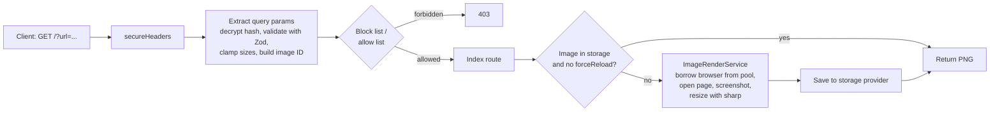

# PageSnap

PageSnap is a self-hosted HTTP service that turns any web page URL into a PNG screenshot, with optional caching in S3, CouchDB or the local filesystem.

## What This Project Does

Many apps need a picture of a web page: link previews, thumbnails in dashboards, social cards or visual archives. Taking those screenshots means running a headless browser, which is heavy to embed in every app. PageSnap runs that browser once as a small service. You send it a URL in a query string, and it returns an image.

It is meant for developers who want a screenshot endpoint they can run on their own infrastructure, in Docker or directly with Node.js.

Main features:

- **URL to PNG over HTTP**: `GET /?url=https://example.com` returns a PNG image.
- **Configurable rendering**: output `width`/`height`, browser `viewportWidth`/`viewportHeight`, full-page capture, mobile emulation, dark mode and device scale factor, all as query parameters.
- **Sensible limits**: every dimension is capped at 1920px, and only `http`/`https` URLs are accepted.
- **Pluggable image cache**: store rendered images in Amazon S3 (or any S3-compatible store such as MinIO), CouchDB or the local filesystem, or turn caching off with the stub provider.
- **Browser pool**: Chromium instances are reused through a configurable pool instead of launched per request.
- **Domain allow and block lists**: restrict which hosts may be screenshotted.
- **Encrypted requests**: optionally require all request options to arrive as one AES-GCM encrypted `hash` parameter, so clients cannot change the options.
- **Health and metrics endpoints**: `GET /ping` and an optional `GET /metrics` that reports browser pool usage.
- **Usable as a library**: `src/mod.ts` exports the render service, browser pool, schema and storage providers.

## How It Works

Every screenshot request goes through a small chain of Hono middlewares before it reaches the route that renders or loads the image.



1. **Startup** (`src/main.ts`): loads `.env` and builds the storage provider, browser pool and render service from environment variables (`src/lib/factory.ts`). If `CRYPTO_KEY` is set, it also creates the encryption service. Then it starts the Hono app on `PORT` (default `3089`).
2. **Parsing input** (`src/middlewares/extract_query_params.ts`): reads the query string, or decrypts the `hash` parameter when encryption is enabled. It validates the result against the Zod schema in `src/lib/schema.ts`, caps dimensions at 1920px and builds a stable image ID.
3. **Access control** (`src/middlewares/block_list.ts`, `allow_list.ts`): if `BLOCK_LIST` or `ALLOW_LIST` is set, the target host is checked, and the request is rejected with `403` when it isn't allowed.
4. **Cache lookup** (`src/routes/index.ts`): the route asks the storage provider for the image ID. On a hit, the cached PNG is returned straight away.
5. **Rendering** (`src/lib/image_render.ts`): on a miss, or when `forceReload=true`, a Chromium browser is borrowed from the pool (`src/lib/browser_pool.ts`). It opens a page with the requested viewport, mobile and dark-mode settings and takes the screenshot. `sharp` then resizes the image to the requested width or height.
6. **Storing and responding**: the PNG is saved to the storage provider and returned with `Content-Type: image/png` and a `Cache-Control` header.

**Image IDs and caching.** The image ID combines today's date, a slug of the URL and the sorted rendering options. `url`, `hash` and `forceReload` don't count as rendering options. As a result, the same request is rendered at most once per day per set of options.

**Encryption mode.** When `CRYPTO_KEY` is set, plain query parameters are rejected. Clients must send `?hash=str-enc:...`, which holds the JSON options encrypted with that key. Without `CRYPTO_KEY`, a `hash` parameter is rejected instead.

### Query parameters

| Parameter | Type | Description |
|---|---|---|
| `url` | string (required) | Page to capture; must start with `http://` or `https://` |
| `width` | number | Output image width in pixels (max 1920) |
| `height` | number | Output image height in pixels (max 1920); applied only to full-page captures when `width` is not set |
| `viewportWidth` | number | Browser viewport width (default 1080, max 1920) |
| `viewportHeight` | number | Browser viewport height (default 1080, max 1920) |
| `isFullPage` | `true`/`false` | Capture the whole scrollable page |
| `isMobile` | `true`/`false` | Emulate a mobile device |
| `isDarkMode` | `true`/`false` | Render with the `dark` color scheme |
| `deviceScaleFactor` | number | Device pixel ratio (default 1) |
| `forceReload` | `true`/`false` | Ignore the cache and render again |
| `hash` | string | Encrypted options (only when `CRYPTO_KEY` is set) |

If neither `width` nor `height` is given, the image is resized to 250px wide (the default viewport is square, so a normal capture comes out 250×250). The aspect ratio is always kept.

### Endpoints

| Method | Path | Description |
|---|---|---|
| `GET` | `/` | Render or fetch a screenshot (see query parameters) |
| `GET` | `/ping` | Health check, returns `"pong"` |
| `GET` | `/metrics` | Browser pool metrics (only when `METRICS=true`) |

## Project Structure

```
pagesnap/
├── src/
│   ├── main.ts                      # Entry point: reads env, wires services, starts the HTTP server
│   ├── app.ts                       # Builds the Hono app: headers, error handler, middlewares, routes
│   ├── mod.ts                       # Library exports (render service, pool, schema, storage providers)
│   ├── routes/
│   │   └── index.ts                 # GET / - cache lookup, render, store and return the PNG
│   ├── middlewares/
│   │   ├── extract_query_params.ts  # Parses/decrypts input, validates it, builds the image ID
│   │   ├── allow_list.ts            # Rejects hosts that are not in ALLOW_LIST
│   │   └── block_list.ts            # Rejects hosts that are in BLOCK_LIST
│   └── lib/
│       ├── browser_pool.ts          # generic-pool of Playwright Chromium browsers
│       ├── image_render.ts          # Opens the page, takes the screenshot, resizes with sharp
│       ├── factory.ts               # Creates pool, render service and storage from env vars
│       ├── schema.ts                # Zod schema for query parameters and dimension clamping
│       ├── utils.ts                 # Image ID builder, slugify, domain list parsing
│       ├── logger.ts                # pino logger
│       └── storage/
│           ├── _base.ts             # ImageStorage interface
│           ├── s3.ts                # Amazon S3 / S3-compatible provider
│           ├── couch-db.ts          # CouchDB attachment provider
│           ├── filesystem.ts        # Local directory provider
│           └── stub.ts              # No-op provider (no caching)
├── tests/
│   ├── app.spec.ts                  # HTTP tests for routes, validation and encryption
│   ├── schema.spec.ts               # Schema and clamping tests
│   ├── image_id.spec.ts             # Image ID / cache key tests
│   ├── storage_filesystem.spec.ts   # Filesystem provider tests
│   ├── storage_couchdb.spec.ts      # CouchDB provider tests with a mocked client
│   └── helpers/                     # Stub render service and a test image
├── .env.sample                      # Example environment configuration
├── Dockerfile                       # Multi-stage image based on the Playwright image
├── docker-compose.yml               # App plus CouchDB and MinIO for local testing
├── .mise.toml                       # Tool versions (Node 20, pnpm 9)
├── tsconfig.json                    # TypeScript config (src + tests)
├── tsconfig.build.json              # Build config (src only)
├── package.json                     # Scripts and dependencies
└── LICENSE                          # MIT license
```

## Tech Stack

| Layer | Technology | Purpose |
|---|---|---|
| Runtime | Node.js >= 20 | Runs the service |
| Language | TypeScript ^5.4.5 | Typed source, compiled with `tsc` |
| HTTP server | Hono ^4.3.10 + @hono/node-server ^1.11.1 | Routing, middlewares, secure headers |
| Browser | Playwright ^1.44.1 (Chromium) | Loads pages and takes screenshots |
| Pooling | generic-pool ^3.9.0 | Reuses browser instances |
| Image processing | sharp ^0.33.4 | Resizes screenshots |
| Validation | Zod ^3.23.8 + zod-ff ^1.4.0 | Validates query parameters |
| Encryption | @jmondi/string-encrypt-decrypt ^0.0.6 | AES-GCM encrypted request options |
| Storage | @aws-sdk/client-s3 ^3.583.0, nano ^10.1.3, Node `fs` | S3, CouchDB and filesystem caching |
| Logging | pino ^9.1.0, pino-pretty ^11.1.0 | Structured logs, pretty output in dev |
| Config | dotenv ^16.4.5 | Loads `.env` |
| Testing | Vitest ^1.6.0, @vitest/coverage-v8 ^1.6.0 | Unit and HTTP tests, coverage |
| Dev tooling | tsx ^4.11.0, Prettier ^3.2.5, npm-run-all ^4.1.5 | Watch mode, formatting, script chaining |
| Package manager | pnpm >= 9 | Dependency management |
| Deployment | Docker (Playwright v1.44.1 image), Docker Compose | Container image and local stack |

## Usage

Install dependencies and the Chromium browser used for rendering:

```bash
pnpm install
pnpm exec playwright install chromium
```

Start the server in watch mode:

```bash
pnpm dev
```

Then request a screenshot:

```
http://localhost:3089/?url=https://example.com
http://localhost:3089/?url=https://example.com&width=600&isFullPage=true
```

Configuration is read from environment variables. Copy `.env.sample` to `.env` and adjust it.

### Environment variables

| Variable | Description | Example |
|---|---|---|
| `PORT` | Port to listen on | `3089` |
| `LOG_LEVEL` | `debug`, `info`, `warn` or `error` | `info` |
| `NODE_ENV` | `development` or `production` | `development` |
| `ALLOW_LIST` | Comma-separated hosts that may be captured | `example.com,github.com` |
| `BLOCK_LIST` | Comma-separated hosts that may not be captured | `example.org` |
| `CACHE_CONTROL` | `Cache-Control` header for image responses | `public, max-age=86400, immutable` |
| `BROWSER_TIMEOUT` | Page load timeout in ms | `10000` |
| `BROWSER_WAIT_UNTIL` | `load`, `domcontentloaded` or `networkidle` | `domcontentloaded` |
| `POOL_MIN` / `POOL_MAX` | Minimum / maximum browsers in the pool | `2` / `10` |
| `POOL_MAX_WAITING_CLIENTS` | Max queued requests waiting for a browser | `50` |
| `POOL_IDLE_TIMEOUT_MS` | Idle time before a browser is closed | `15000` |
| `METRICS` | Enable `GET /metrics` | `false` |
| `CRYPTO_KEY` | AES-GCM key as JWK JSON; enables encryption mode | `{"kty":"oct",...}` |
| `DEFAULT_WIDTH` / `DEFAULT_HEIGHT` | Default output size | `250` / `250` |
| `DEFAULT_VIEWPORT_WIDTH` / `DEFAULT_VIEWPORT_HEIGHT` | Default viewport size | `1080` / `1080` |
| `DEFAULT_IS_MOBILE` / `DEFAULT_IS_FULL_PAGE` / `DEFAULT_IS_DARK_MODE` | Default flags | `false` |
| `DEFAULT_DEVICE_SCALE_FACTOR` | Default device pixel ratio | `1` |
| `STORAGE_PROVIDER` | `stub`, `filesystem`, `s3` or `couchdb` | `stub` |
| `IMAGE_STORAGE_PATH` | Directory for the `filesystem` provider | `./storage` |
| `AWS_BUCKET` | Bucket for the `s3` provider | `my-screenshots` |
| `AWS_ACCESS_KEY_ID` / `AWS_SECRET_ACCESS_KEY` | S3 credentials | `your-access-key` |
| `AWS_DEFAULT_REGION` | S3 region | `us-east-1` |
| `AWS_ENDPOINT_URL_S3` | Custom S3 endpoint (e.g. MinIO) | `http://localhost:9000` |
| `AWS_FORCE_PATH_STYLE` | Use path-style S3 URLs | `false` |
| `COUCH_DB_PROTOCOL` / `COUCH_DB_HOST` / `COUCH_DB_PORT` | CouchDB connection | `http` / `localhost` / `5984` |
| `COUCH_DB_USER` / `COUCH_DB_PASS` | CouchDB credentials | `admin` / `your-password` |
| `COUCHDB_DATABASE` | CouchDB database name | `images` |

## Storage Providers

Rendered images can be cached so the same request is not rendered twice. Pick a provider with `STORAGE_PROVIDER`:

| Provider | Value | Settings |
|---|---|---|
| None (default) | `stub` | none |
| Local directory | `filesystem` | `IMAGE_STORAGE_PATH` |
| Amazon S3 / S3-compatible | `s3` | `AWS_BUCKET`, `AWS_ACCESS_KEY_ID`, `AWS_SECRET_ACCESS_KEY`, `AWS_DEFAULT_REGION`, `AWS_ENDPOINT_URL_S3`, `AWS_FORCE_PATH_STYLE` |
| CouchDB | `couchdb` | `COUCH_DB_PROTOCOL`, `COUCH_DB_HOST`, `COUCH_DB_PORT`, `COUCH_DB_USER`, `COUCH_DB_PASS` |

## Docker

```bash
docker build -t pagesnap .
docker run --rm -p 3089:3089 pagesnap
```

`docker compose up --build` starts the app together with CouchDB and MinIO for local testing.

## License

MIT, see [LICENSE](LICENSE).
