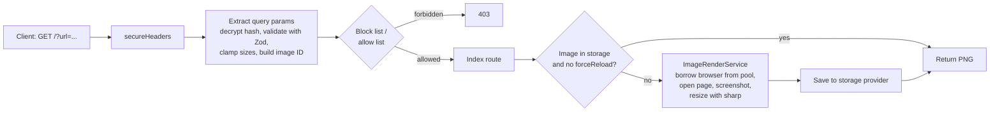

# PageSnap

PageSnap is a self-hosted HTTP service that turns any web page URL into a PNG screenshot, with optional caching in S3, CouchDB or the local filesystem.

## What This Project Does

Many apps need a picture of a web page: link previews, thumbnails in dashboards, social cards or visual archives. Taking those screenshots means running a headless browser, which is heavy to embed in every app. PageSnap runs that browser once as a small service. You send it a URL in a query string, and it returns an image.

It is meant for developers who want a screenshot endpoint they can run on their own infrastructure, in Docker or directly with Node.js.

Main features:

- **URL to PNG over HTTP**: `GET /?url=https://example.com` returns a PNG image.
- **Configurable rendering**: output `width`/`height`, browser `viewportWidth`/`viewportHeight`, full-page capture, mobile emulation, dark mode and device scale factor, all as query parameters.
- **Sensible limits**: every dimension is capped at 1920px, and only `http`/`https` URLs are accepted.
- **Pluggable image cache**: store rendered images in Amazon S3 (or any S3-compatible store such as MinIO), CouchDB or the local filesystem, or turn caching off with the stub provider.
- **Browser pool**: Chromium instances are reused through a configurable pool instead of launched per request.
- **Domain allow and block lists**: restrict which hosts may be screenshotted.
- **Encrypted requests**: optionally require all request options to arrive as one AES-GCM encrypted `hash` parameter, so clients cannot change the options.
- **Health and metrics endpoints**: `GET /ping` and an optional `GET /metrics` that reports browser pool usage.
- **Usable as a library**: `src/mod.ts` exports the render service, browser pool, schema and storage providers.

## How It Works

Every screenshot request goes through a small chain of Hono middlewares before it reaches the route that renders or loads the image.



1. **Startup** (`src/main.ts`): loads `.env` and builds the storage provider, browser pool and render service from environment variables (`src/lib/factory.ts`). If `CRYPTO_KEY` is set, it also creates the encryption service. Then it starts the Hono app on `PORT` (default `3089`).
2. **Parsing input** (`src/middlewares/extract_query_params.ts`): reads the query string, or decrypts the `hash` parameter when encryption is enabled. It validates the result against the Zod schema in `src/lib/schema.ts`, caps dimensions at 1920px and builds a stable image ID.
3. **Access control** (`src/middlewares/block_list.ts`, `allow_list.ts`): if `BLOCK_LIST` or `ALLOW_LIST` is set, the target host is checked, and the request is rejected with `403` when it isn't allowed.
4. **Cache lookup** (`src/routes/index.ts`): the route asks the storage provider for the image ID. On a hit, the cached PNG is returned straight away.
5. **Rendering** (`src/lib/image_render.ts`): on a miss, or when `forceReload=true`, a Chromium browser is borrowed from the pool (`src/lib/browser_pool.ts`). It opens a page with the requested viewport, mobile and dark-mode settings and takes the screenshot. `sharp` then resizes the image to the requested width or height.
6. **Storing and responding**: the PNG is saved to the storage provider and returned with `Content-Type: image/png` and a `Cache-Control` header.

**Image IDs and caching.** The image ID combines today's date, a slug of the URL and the sorted rendering options. `url`, `hash` and `forceReload` don't count as rendering options. As a result, the same request is rendered at most once per day per set of options.

**Encryption mode.** When `CRYPTO_KEY` is set, plain query parameters are rejected. Clients must send `?hash=str-enc:...`, which holds the JSON options encrypted with that key. Without `CRYPTO_KEY`, a `hash` parameter is rejected instead.

## Usage

Install dependencies and the Chromium browser used for rendering:

```bash
pnpm install
pnpm exec playwright install chromium
```

Start the server in watch mode:

```bash
pnpm dev
```

Then request a screenshot:

```
http://localhost:3089/?url=https://example.com
http://localhost:3089/?url=https://example.com&width=600&isFullPage=true
```

Configuration is read from environment variables. Copy `.env.sample` to `.env` and adjust it.

## Storage Providers

Rendered images can be cached so the same request is not rendered twice. Pick a provider with `STORAGE_PROVIDER`:

| Provider | Value | Settings |
|---|---|---|
| None (default) | `stub` | none |
| Local directory | `filesystem` | `IMAGE_STORAGE_PATH` |
| Amazon S3 / S3-compatible | `s3` | `AWS_BUCKET`, `AWS_ACCESS_KEY_ID`, `AWS_SECRET_ACCESS_KEY`, `AWS_DEFAULT_REGION`, `AWS_ENDPOINT_URL_S3`, `AWS_FORCE_PATH_STYLE` |
| CouchDB | `couchdb` | `COUCH_DB_PROTOCOL`, `COUCH_DB_HOST`, `COUCH_DB_PORT`, `COUCH_DB_USER`, `COUCH_DB_PASS` |

## Docker

```bash
docker build -t pagesnap .
docker run --rm -p 3089:3089 pagesnap
```

`docker compose up --build` starts the app together with CouchDB and MinIO for local testing.

## License

MIT, see [LICENSE](LICENSE).
